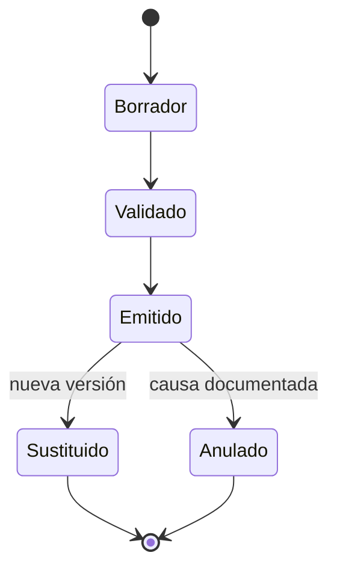
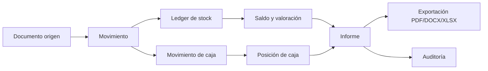
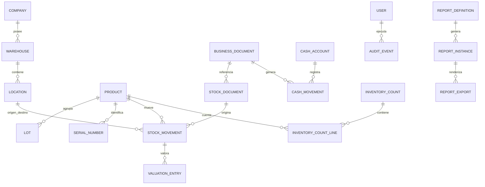

# Arquitectura documental y plantillas profesionales para el rediseño de reportes de GESTIA

iturn597150image2

## Resumen ejecutivo

GESTIA debería evolucionar desde un **generador de resúmenes de gestión** hacia un **subsistema documental trazable**, pero sin presentarse todavía como un sistema de contabilidad financiera formal mientras no exista partida doble, libro mayor y conciliación contable integral. Esa distinción es esencial: con los datos actuales GESTIA sí puede emitir documentos profesionales como **Informe Financiero de Gestión**, **Informe de Caja**, **Informe de Existencias**, **Libro de Movimientos de Almacén**, **Informe de Inventario Físico** e **Informe de Auditoría**; no debería denominar esos documentos «Estado de Resultados», «Balance General» o «Estado de Flujos de Efectivo» en sentido contable formal. La NIC 2 y la normativa cubana sobre inventarios distinguen claramente entre medición del inventario, reconocimiento del coste como gasto e información financiera; además, la Norma Cubana de Contabilidad No. 9 establece reglas específicas para valoración y exposición de inventarios. citeturn605596search0turn600195view0turn482164view1

El documento actual de GESTIA constituye una buena base editorial —cabecera corporativa, período, fecha de emisión, monedas, módulos y conclusiones—, pero mezcla indicadores de gestión con terminología contable que puede interpretarse como información financiera formal. En el informe suministrado, por ejemplo, se denomina «margen neto» a una relación basada en entradas y salidas de efectivo y «índice de rotación» a salidas/entradas; además se suman unidades heterogéneas de productos diferentes. Esos conceptos deberían reclasificarse en el nuevo motor documental. fileciteturn0file0

La arquitectura recomendada tiene cuatro capas independientes:

**registro operacional → motor de cálculo → modelo documental versionado → renderizadores de salida**.

Esta separación permite que un mismo conjunto de datos produzca un PDF cerrado para un auditor, un DOCX editable para dirección, un XLSX analítico o un CSV de intercambio sin duplicar lógica de negocio. Los ERP maduros siguen una filosofía semejante en cuanto a separar movimientos detallados, valoración e informes: ERPNext utiliza un *Stock Ledger* granular; Business Central ofrece informes independientes de transacciones, disponibilidad y valoración; Odoo mantiene movimientos de existencias y valoración trazables hasta sus referencias. citeturn318351search5turn318351search6turn352258search3

La recomendación de producto es introducir dos modos:

| Modo | Usuario | Qué ve |
|---|---|---|
| **Básico** | Propietario, encargado, microempresa | Indicadores esenciales, lenguaje sencillo, pocas opciones |
| **Profesional** | Gerencia, contabilidad, auditoría, terceros | criterios de cálculo, filtros, trazabilidad, valoración, anexos, versiones y firmas |

Ambos deben consumir exactamente el mismo modelo de datos. La diferencia debe ser **la profundidad de presentación, no la calidad de los registros**.

## Arquitectura documental propuesta

### Taxonomía y terminología que debería adoptar GESTIA

El vocabulario debería diferenciar tres dominios que actualmente pueden confundirse:

| Concepto GESTIA recomendado | Significado |
|---|---|
| **Inventario / existencias** | Bienes destinados a venta, consumo, producción o prestación de servicios |
| **Almacén** | Instalación o ubicación lógica donde se custodian existencias |
| **WMS** | Funcionalidad de gestión física de almacenes: ubicaciones, recepción, put-away, picking, packing, despacho, conteos |
| **ERP** | Sistema integrado que conecta operaciones, compras, ventas, inventario, finanzas, etc. |
| **Activo / equipamiento** | Bien durable usado por la empresa; no debe mezclarse automáticamente con existencias comerciales |
| **SKU** | Identificador interno de una unidad comercial o variante gestionable |
| **Lote** | Grupo de unidades que comparten un identificador de trazabilidad |
| **Número de serie** | Identificador único de una unidad específica |
| **COGS / Cost of Goods Sold** | Coste de las mercancías vendidas; solo debe calcularse cuando existe un método de valoración consistente |
| **FIFO / PEPS** | Las primeras unidades valoradas en entrar son las primeras consumidas para determinar coste |
| **Promedio móvil** | El coste promedio se recalcula después de cada entrada |
| **LIFO / UEPS** | Último en entrar, primero en salir; no debe ser una opción de valoración para GESTIA Cuba/NIIF |
| **FEFO** | Primero en caducar, primero en salir; regla física de extracción, no fórmula contable de valoración |

La NCC No. 9 cubana define inventarios como recursos materiales destinados al consumo, distribución o comercialización y admite FIFO y Precio Promedio Móvil. La norma establece además que una entidad debe aplicar la misma fórmula a inventarios de naturaleza y uso similares. citeturn561145view0turn561145view2 La NIC 2 y la NIIF para PYMES admiten FIFO y promedio ponderado para partidas intercambiables; esta última establece expresamente que LIFO no está permitido. citeturn605596search0turn605596search7

Odoo ilustra además una distinción importante para el diseño: puede utilizarse una estrategia física LIFO o FEFO para seleccionar qué unidades salen mientras la valoración financiera continúa siendo FIFO o promedio. citeturn318351search0

### Identificación documental

Cada documento emitido debe existir como objeto independiente y tener un identificador inmutable. Recomiendo:

`GESTIA-{TIPO}-{EMPRESA}-{AAAA}-{SECUENCIA}`

Ejemplos:

`GESTIA-IFG-ELNAC-2026-000014`  
`GESTIA-ALM-ELNAC-2026-000031`  
`GESTIA-AUD-ELNAC-2026-000006`

El número secuencial nunca debería reutilizarse, incluso si un documento se anula.

### Metadatos mínimos

| Campo | Obligatorio | Ejemplo |
|---|---:|---|
| ID del documento | Sí | GESTIA-ALM-ELNAC-2026-000031 |
| Tipo documental | Sí | Informe de almacén |
| Empresa / entidad | Sí | Centro de Empoderamiento ELNAC |
| NIT / identificación | Según configuración | CEELNAC |
| Período desde / hasta | Sí | 01/01/2026–31/12/2026 |
| Fecha y hora de corte | Sí | 31/12/2026 23:59 |
| Fecha y hora de generación | Sí | 04/01/2027 09:21 |
| Zona horaria | Sí | America/Havana |
| Autor / generador | Sí | Roberto Verdecia |
| Responsable / aprobador | Profesional | Administrador financiero |
| Estado | Sí | Borrador / Emitido / Sustituido / Anulado |
| Versión | Sí | 1.0 |
| Plantilla | Sí | ALM-2.1 |
| Fuente de datos | Sí | Almacén, movimientos registrados |
| Criterio de cálculo | Sí | Promedio móvil |
| Moneda funcional | Sí si hay valores | CUP |
| Monedas informativas | Opcional | USD |
| Tasa de cambio | Si se convierte | 1 USD = X CUP |
| Fuente de tasa | Si se convierte | Configuración de empresa |
| Filtros | Sí | Almacén principal; categoría Bebidas |
| Hash / huella | Profesional | SHA-256… |
| ID de exportación | Sí | EXP-20261104-00215 |

Para informes externos recomendaría además mostrar en el pie de página **ID · versión · página X de Y · fecha de corte · clasificación**.

### Estados y control de versiones

Un informe no debería poder editarse silenciosamente una vez emitido. Business Central registra quién cambió un dato, qué cambió y cuándo; ERPNext ofrece versionado de documentos y comparación de documentos enmendados. Son buenos patrones para GESTIA. citeturn352258search0turn352258search6turn352258search7

Regla propuesta: **un documento Emitido nunca se modifica**. Una corrección crea versión 1.1 o 2.0 y mantiene un enlace `reemplaza_documento_id`.

### Arquitectura de trazabilidad

El principio central debe ser: **ningún número agregado sin posibilidad de llegar hasta sus movimientos origen**. Odoo muestra la referencia del movimiento y permite seguir lotes y números de serie a través de su ciclo de vida; ERPNext registra cantidad, valor, almacén y tipo de operación en el Stock Ledger. citeturn352258search3turn352258search4turn318351search5

## Plantillas profesionales

### Resumen ejecutivo de gestión

No debe ser un volcado de datos, sino una vista de excepción y decisión.

| Bloque | Contenido |
|---|---|
| Portada | empresa, título, período, ID, versión, estado |
| Alcance | módulos incluidos y exclusiones |
| Indicadores clave | caja, ventas/ingresos, obligaciones, stock, alertas |
| Comparación | período actual vs anterior |
| Excepciones | desviaciones, faltantes, inventario lento, documentos pendientes |
| Análisis | texto automático contextual |
| Riesgos | concentración, liquidez operativa, stock bajo, discrepancias |
| Conclusión | observaciones verificables, sin aconsejar decisiones financieras no sustentadas |
| Anexo | metodología y enlaces a informes de detalle |

Ejemplo interpretativo correcto:

> «Durante el período se registraron entradas de efectivo por USD 1.583,00 y salidas por USD 353,40, lo que produjo un flujo neto registrado de USD 1.229,60. Este indicador describe movimientos de caja y no equivale por sí mismo a utilidad contable.»

Esto corrige el uso actual de «margen neto» sobre entradas/salidas que aparece en el informe de GESTIA. fileciteturn0file0

Visualizaciones recomendadas: barras de entradas/salidas por mes; línea de saldo de caja; columnas de inventario valorizado; panel de excepciones. Evitar gráficos circulares para series temporales.

### Informe financiero de gestión

Mientras no exista partida doble, debería llamarse exactamente **Informe Financiero de Gestión — Base de Registros Operacionales**.

| Tabla | Campos |
|---|---|
| Resumen por moneda | moneda, saldo inicial, entradas, salidas, flujo neto, saldo registrado |
| Entradas | fecha, documento, contraparte, categoría, método, moneda, importe |
| Salidas | fecha, documento, contraparte, categoría, método, moneda, importe |
| Por cobrar | contraparte, documento, vencimiento, moneda, saldo |
| Por pagar | contraparte, documento, vencimiento, moneda, saldo |
| Cambio | moneda origen, moneda destino, tasa, fecha, fuente |
| Conciliación | saldo registrado, partidas pendientes, saldo conciliado |

Texto metodológico obligatorio:

> «El presente documento se prepara sobre registros de gestión y no constituye un estado financiero preparado mediante contabilidad de partida doble.»

En Cuba, una regulación de 2020 que modificó la Resolución 235 estableció el CUP como moneda de presentación y registro para las entidades comprendidas, valorando moneda extranjera según la tasa aplicable, con excepciones específicas. Dado que la regulación puede depender del tipo de entidad, GESTIA debería tratar esto como configuración jurisdiccional y no como regla universal codificada sin asesoramiento contable. citeturn290750search7 En enero de 2026 se publicó además una modificación de la norma específica relativa a operaciones en moneda extranjera, lo que refuerza la necesidad de parametrizar la fuente y fecha de la tasa en lugar de hardcodearla. citeturn748474search1

### Informe de almacén y valoración

Éste debería sustituir al actual resumen de «entradas 56 / salidas 23» cuando se pretenda un informe profesional.

| SKU | UDM | Inicial | Entradas | Salidas | Ajustes | Final | Coste unit. | Valor final |
|---|---|---:|---:|---:|---:|---:|---:|---:|
| CAF-500 | paquete | 5 | 10 | 6 | 0 | 9 | 4,25 | 38,25 |
| AGUA-19 | unidad | 3 | 6 | 5 | −1 | 3 | 6,00 | 18,00 |

Debe poder agruparse por almacén, ubicación, categoría, SKU, lote, serie y estado.

Business Central estructura su informe de valoración precisamente alrededor de **saldo inicial, aumentos, disminuciones y saldo final, tanto en cantidad como en valor**. citeturn318351search2turn318351search3 Odoo permite analizar cantidades y valores por producto y ubicación y consultar históricamente una fecha concreta. citeturn318351search0

Texto interpretativo:

> «El valor del inventario al cierre asciende a CUP X según el método de Precio Promedio Móvil. Los movimientos posteriores a la fecha de corte no se incluyen.»

### Libro de movimientos / Kardex

Éste es uno de los documentos más importantes para auditoría.

| Campo |
|---|
| fecha y hora efectiva |
| fecha de registro |
| movimiento_id |
| referencia |
| documento origen |
| SKU |
| lote / serie |
| almacén origen |
| ubicación origen |
| almacén destino |
| ubicación destino |
| entrada |
| salida |
| UDM |
| coste de entrada |
| coste de salida |
| coste de valoración |
| saldo cantidad |
| saldo valor |
| usuario |
| estado |
| observación |

Un ejemplo de línea:

| Fecha | Ref. | SKU | Entrada | Salida | Saldo | Coste val. | Valor saldo |
|---|---|---|---:|---:|---:|---:|---:|
| 02/11/26 | REC-0048 | CAF-500 | 10 | — | 15 | 4,20 | 63,00 |
| 03/11/26 | VTA-0121 | CAF-500 | — | 2 | 13 | 4,20 | 54,60 |

ERPNext denomina este enfoque *Stock Ledger* y registra movimientos de compra, venta, transferencia y fabricación junto con cantidad, valor, artículo y almacén. citeturn318351search5

### Informe de inventario físico

Debe registrar un **evento de conteo**, no sobrescribir simplemente la cantidad del producto.

| Campo | Ejemplo |
|---|---|
| Conteo | CNT-2026-0015 |
| Ubicación | Almacén Principal / Estante B |
| SKU | CAF-500 |
| Existencia sistema | 13 |
| Conteo físico | 12 |
| Diferencia | −1 |
| Coste unitario | 4,20 |
| Diferencia monetaria | −4,20 |
| Causa | Rotura |
| Contado por | Usuario A |
| Verificado por | Usuario B |
| Ajuste generado | AJU-2026-003 |

Para productos con trazabilidad, debe realizarse por lote o serie. Odoo diferencia lote —grupo de artículos— y número de serie —identificador individual— y mantiene trazabilidad completa de origen, almacenamiento y destino. citeturn605596search3turn352258search4

### Informe de auditoría

No debe consistir únicamente en un listado de actividad del usuario. Debe responder: **quién, qué, cuándo, desde dónde, antes, después y por qué**.

| Fecha/hora | Usuario | Acción | Objeto | Antes | Después | Motivo | IP/sesión |
|---|---|---|---|---|---|---|---|
| 04/11 10:42 | rv@… | modificar | MOV-488 | qty=5 | qty=4 | corrección | … |

Para operaciones financieras o stock ya confirmadas es preferible **reversar** en lugar de editar. De esa forma la historia matemática permanece reproducible.

### Conciliación caja–inventario

Esta plantilla es especialmente útil para comercios pequeños porque relaciona operaciones sin fingir que existe contabilidad general.

| Documento | Venta | Coste inventario | Cobrado | Por cobrar | Diferencia | Estado |
|---|---:|---:|---:|---:|---:|---|
| VTA-103 | 100 | 55 | 100 | 0 | 0 | conciliado |
| VTA-104 | 80 | 42 | 50 | 30 | 0 | parcial |

La reconciliación debería responder tres preguntas separadas:

**¿se entregó? → almacén**  
**¿se facturó/registró? → operación comercial**  
**¿se cobró? → caja/cuenta**

No conviene suponer que las tres ocurren simultáneamente.

## Esquema de datos mínimo

El rediseño documental será difícil de sostener si los informes se siguen construyendo directamente desde tablas simples de «producto + cantidad». El modelo debería evolucionar hacia un **ledger de movimientos inmutable**. Odoo mantiene valoración ligada a movimientos físicos; ERPNext registra sus transacciones en un ledger y recalcula valoración según el método elegido. citeturn318351search1turn318351search4

| Entidad | Campos esenciales |
|---|---|
| `company` | id, nombre, identificación, moneda_funcional, timezone |
| `product` | id, sku, nombre, categoría, tipo, udm_base |
| `product_uom` | producto, udm, factor_conversion |
| `warehouse` | id, empresa, nombre |
| `location` | id, warehouse_id, parent_id, código |
| `lot` | id, producto, lote, fabricación, caducidad |
| `serial_number` | id, producto, serial |
| `stock_document` | id, tipo, número, fecha, estado, origen |
| `stock_movement` | id, documento, producto, qty, origen, destino, fecha |
| `valuation_entry` | movimiento, método, qty, coste_unitario, valor |
| `cash_account` | id, moneda, tipo |
| `cash_movement` | id, cuenta, documento_origen, importe, moneda |
| `business_document` | id, tipo, contraparte, referencia |
| `inventory_count` | id, almacén, fecha, estado |
| `inventory_count_line` | conteo, producto, teórico, contado |
| `user` | id, identidad, estado |
| `role` | id, nombre |
| `audit_event` | actor, objeto, acción, timestamp, before, after |
| `report_definition` | código, plantilla, versión |
| `report_instance` | ID, definición, fecha_corte, parámetros, estado |
| `report_export` | formato, hash, generado_por, timestamp |

El `stock_movement` debe representar **delta de cantidad**, no nuevo saldo. El saldo es una derivación de los movimientos confirmados hasta una fecha.

Para estándares externos, GESTIA debería permitir almacenar códigos internos y, opcionalmente, identificadores GS1. GS1 utiliza GTIN para artículos comerciales, GLN para ubicaciones y SSCC para unidades logísticas; los códigos de barras también pueden transportar lote, serie y fechas. citeturn953968search0turn953968search2turn953968search3 Para GESTIA esto debería ser opcional, no obligatorio para una microempresa.

## Reglas de cálculo y ejemplos numéricos

### Ecuación fundamental de stock

Por SKU + ubicación + lote/serie, cuando corresponda:

`Stock final = Stock inicial + Entradas − Salidas ± Ajustes`

Business Central utiliza esta estructura para su informe de valoración y acumula entradas y salidas entre la fecha inicial y final. citeturn318351search2turn318351search3

**No debe calcularse un stock global sumando botellas, cajas, kg y electrodomésticos.**

Los totales de cantidad solo son válidos dentro de una UDM homogénea o como número de líneas/SKU.

### Promedio móvil

Ejemplo:

Existencia inicial:

10 unidades × $10 = $100.

Nueva compra:

10 unidades × $14 = $140.

Nuevo promedio:

`($100 + $140) / 20 = $12`

Salida de 5:

`COGS de gestión = 5 × $12 = $60`

Stock restante:

`15 × $12 = $180`

ERPNext describe la misma lógica: el promedio se recalcula al entrar nuevas unidades y las salidas usan la tasa promedio vigente. citeturn318351search4 La NCC No. 9 describe el Precio Promedio Móvil como el cálculo de un nuevo precio promedio después de cada entrada, valorando las salidas al último promedio calculado. citeturn561145view2

### FIFO

Compra A:

10 × $10.

Compra B:

10 × $14.

Salida de 15:

`10 × $10 + 5 × $14 = $170`

Quedan:

`5 × $14 = $70`

La NIC 2 admite FIFO para inventarios intercambiables y la NCC No. 9 cubana recoge igualmente FIFO. citeturn605596search0turn561145view0

### Coste de mercancías vendidas

Para mercancía destinada a venta:

`COGS = coste valorado de las unidades efectivamente vendidas/salidas`

No debería inferirse como:

`compras del período`

ni como:

`dinero pagado a proveedores`.

La NIC 2 dispone que cuando el inventario se vende, su importe en libros se reconoce como gasto en el período en que se reconoce el ingreso relacionado. citeturn605596search0 La NCC No. 9 contiene una regla equivalente para inventarios vendidos. citeturn561145view0

Mientras GESTIA no implemente contabilidad de partida doble, recomiendo denominarlo **«coste valorado de mercancía salida/vendida»**, con una nota metodológica, y reservar «COGS contable» para una futura integración contable.

### Rotación de inventario

No:

`salidas físicas / entradas físicas`

Sí, cuando existen costes fiables:

`Rotación = coste de mercancías vendidas / inventario promedio`

con:

`Inventario promedio = (inventario inicial valorizado + inventario final valorizado) / 2`

Ejemplo:

COGS anual = $12.000  
Inventario inicial = $3.000  
Inventario final = $5.000

Promedio = $4.000

Rotación = `12.000 / 4.000 = 3,0 veces`

### Días de inventario

`Días de inventario = días del período / rotación`

En el ejemplo anual:

`365 / 3 = 121,7 días`

Para una pyme, este indicador es más intuitivo si GESTIA muestra simultáneamente:

**Rotación: 3,0× · Días estimados: 122**

### Valor neto realizable

La NIC 2 mide inventarios al menor entre coste y valor neto realizable. citeturn605596search0 La NCC No. 9 cubana también contempla deterioro y exposición de inventarios de lento movimiento u ociosos. citeturn561145view0 Por ello, una fase profesional posterior debería admitir:

`valor_contable`  
`valor_neto_realizable`  
`deterioro`  
`motivo_deterioro`

La normativa cubana también contempla específicamente inventarios de lento movimiento y ociosos mediante el Decreto 29/2020 y regulaciones complementarias. citeturn748474search2turn748474search3

### Fecha efectiva frente a fecha de registro

Todo movimiento debe almacenar ambas:

`effective_at`: cuándo ocurrió realmente.  
`created_at`: cuándo se introdujo en GESTIA.

Esto hace posible detectar cargas atrasadas.

Los sistemas con valoración perpetua requieren especial cuidado con operaciones retroactivas porque una entrada anterior puede modificar las capas FIFO o el promedio de operaciones posteriores; ERPNext documenta explícitamente esa necesidad de recalcular hacia adelante. citeturn318351search4

## Implementación progresiva y UX

La arquitectura debe introducir rigor **sin obligar a un propietario de cafetería a aprender contabilidad**.

| Fase | Alcance | Impacto UI | Prioridad |
|---|---|---|---|
| Fundación documental | IDs, metadatos, versiones, estados, fecha de corte | Bajo | Muy alta |
| Ledger profesional | movimientos inmutables, referencias, saldos derivados | Medio | Muy alta |
| Reportes rediseñados | ejecutivo, caja, almacén, inventario, auditoría | Medio | Muy alta |
| Valoración | promedio móvil + FIFO | Medio | Alta |
| Trazabilidad | ubicaciones, lotes, series | Opcional/progresivo | Alta |
| Conciliaciones | venta–stock–cobro y conteos físicos | Medio | Alta |
| Analítica | rotación, ageing, tendencias, anomalías | Bajo | Media |
| Ecosistema | API, GS1, integraciones contables | Avanzado | Media |

### Interfaz del generador

La pantalla actual puede evolucionar a:

**Tipo de informe**  
Resumen ejecutivo / Finanzas de gestión / Almacén / Kardex / Inventario físico / Auditoría / Conciliación.

**Período**  
Hoy / Semana / Mes / Trimestre / Año / Personalizado.

**Nivel**  
Ejecutivo / Operativo / Auditoría.

**Ámbito**  
Empresa / almacén / ubicación / categoría / SKU / lote.

**Valoración**  
Sin valorar / Promedio móvil / FIFO.

**Moneda**  
Original / moneda funcional / presentación consolidada.

**Opciones**  
Incluir anexos · incluir gráficos · incluir comprobantes · mostrar metodología.

**Exportar**  
PDF · Word · Excel · CSV.

La UI básica debería ocultar alrededor del 70–80 % de estas opciones tras «Opciones avanzadas».

### Función de cada formato

| Formato | Uso recomendado |
|---|---|
| **PDF** | copia oficial emitida, terceros, archivo, firma |
| **DOCX** | informe narrativo editable antes de emisión |
| **XLSX** | análisis profesional, filtros y conciliaciones |
| **CSV** | intercambio de datos y auditoría masiva |
| **JSON/API** | futura integración entre sistemas |

La instancia documental debe guardar sus parámetros independientemente de la exportación. Así, generar PDF y XLSX del mismo informe produce **dos representaciones de la misma instancia**, no dos informes distintos.

### Diseño de PDF profesional

Primera página:

Empresa  
Título documental  
Período  
Estado  
ID  
Versión

Luego:

Resumen ejecutivo  
Indicadores  
Gráficos  
Hallazgos  
Tablas

Finalmente:

Metodología  
Filtros  
Criterios de valoración  
Excepciones  
Anexos  
Firmas/aprobaciones  
Huella documental.

### Gráficos apropiados

Para dirección:

`flujo mensual → columnas/línea`  
`stock valorizado → línea temporal`  
`top categorías → barras horizontales`  
`stock bajo → tabla de excepciones`  
`antigüedad → barras por buckets 0–30 / 31–60 / 61–90 / >90 días`.

Para auditoría, las tablas deben tener prioridad sobre gráficos.

### Pruebas mínimas

| Prueba | Criterio de aceptación |
|---|---|
| Saldo | suma de ledger = saldo mostrado |
| Repetibilidad | mismos datos + mismo corte = mismo resultado |
| FIFO | capas consumidas correctamente |
| Promedio | cada recepción recalcula tasa |
| Retroactividad | política definida para movimientos anteriores |
| UDM | no se agregan unidades incompatibles |
| Moneda | nunca se suman monedas sin conversión explícita |
| Cambio | tasa + fecha + fuente quedan registradas |
| Versionado | documento emitido no se sobreescribe |
| Reversión | corrección mantiene movimiento original |
| Permisos | usuario sin privilegios no aprueba/anula |
| Exportación | PDF/XLSX contienen mismos totales |
| Fecha de corte | movimientos posteriores quedan fuera |
| Auditoría | actor y timestamp reproducibles |

## Auditoría, roles y controles

El modelo de permisos debería acercarse a RBAC: los permisos se otorgan por rol y operación. Odoo soporta permisos de lectura, escritura, creación y eliminación por grupos; ERPNext añade etapas como crear, enviar, cancelar o enmendar un documento. citeturn352258search2turn352258search5

Para GESTIA recomiendo:

| Acción | Operador | Supervisor | Auditor | Administrador |
|---|---:|---:|---:|---:|
| Registrar entrada/salida | ✓ | ✓ | lectura | ✓ |
| Modificar borrador propio | ✓ | ✓ | lectura | ✓ |
| Confirmar movimiento | opcional | ✓ | — | ✓ |
| Revertir confirmado | — | ✓ | — | ✓ |
| Aprobar ajuste físico | — | ✓ | — | ✓ |
| Emitir informe | ✓ | ✓ | lectura | ✓ |
| Sustituir informe | — | ✓ | — | ✓ |
| Anular informe | — | ✓ | — | ✓ |
| Ver auditoría | limitado | ✓ | ✓ | ✓ |
| Configurar valoración | — | — | lectura | ✓ |
| Cambiar permisos | — | — | — | ✓ |

Checklist de control:

| Control | Estado requerido |
|---|---|
| Cada informe tiene ID único | Obligatorio |
| Cada informe indica fecha/hora de corte | Obligatorio |
| Se conserva plantilla y versión utilizadas | Obligatorio |
| Monedas nunca se agregan sin conversión | Obligatorio |
| Cada conversión guarda tasa, fecha y fuente | Obligatorio |
| Cada movimiento tiene documento/origen o causa | Obligatorio |
| Movimientos confirmados no se eliminan | Obligatorio |
| Correcciones se realizan por reversión | Profesional |
| Ajustes físicos requieren motivo | Obligatorio |
| Diferencias significativas requieren aprobación | Configurable |
| FIFO/promedio quedan definidos antes del uso | Obligatorio |
| Los cambios de configuración se auditan | Obligatorio |
| Informes emitidos son inmutables | Obligatorio |
| Sustituciones conservan vínculo al anterior | Obligatorio |
| PDF emitido conserva hash | Profesional |
| Permisos siguen mínimo privilegio | Obligatorio |
| Auditor no necesita permiso de edición | Obligatorio |
| Datos de exportación respetan permisos | Obligatorio |
| Inventario lento/ocioso puede identificarse | Profesional |
| Lote/serie puede rastrearse origen→destino | Cuando se habilite |

La auditoría de Business Central registra qué dato cambió, quién lo cambió y cuándo; Microsoft recomienda además seleccionar cuidadosamente qué datos registrar para evitar costes innecesarios. citeturn352258search0 Esa es una buena guía para GESTIA: **auditar intensamente operaciones de negocio y configuración crítica, no generar ruido indiscriminado**.

Para trazabilidad física futura, GS1 propone registrar eventos críticos —recepción, almacenamiento, expedición, etc.— y los datos clave asociados; el estándar utiliza identificadores interoperables y distingue claramente objeto, lugar y evento. citeturn953968search5turn953968search8

## Referencias priorizadas y decisión de producto

Las fuentes con mayor peso para el rediseño deberían organizarse así:

| Prioridad | Fuente | Aplicación a GESTIA |
|---|---|---|
| Alta | NCC No. 9 Cuba, Resolución 360/2018 | valoración y tratamiento de inventarios |
| Alta | NIC 2 / NIIF para PYMES | terminología y valoración de referencia |
| Alta | Microsoft Business Central | estructura de valoración y conciliación |
| Alta | Odoo 19 | valoración, trazabilidad, movimientos, lotes |
| Alta | ERPNext | stock ledger, FIFO/promedio, permisos, versionado |
| Media | GS1 | identificación, códigos, trazabilidad interoperable |
| Contextual | Decreto cubano 29/2020 | inventario lento y ocioso |

La fuente cubana primaria reproducida en la Gaceta Oficial establece que la NCC No. 9 busca regular reconocimiento, valoración y exposición de inventarios; su tabla de contenidos incluye expresamente costes, métodos de cálculo, reconocimiento como gasto e información a revelar. citeturn482164view0turn482164view1 En sus párrafos sobre cálculo se especifican FIFO y Precio Promedio Móvil. citeturn561145view0

Odoo 19 documenta coste estándar, coste medio y FIFO y permite observar la valoración y sus movimientos de origen. citeturn318351search0turn318351search1 ERPNext documenta FIFO, promedio móvil y un Stock Ledger donde cada movimiento conserva cantidad y valor. citeturn318351search4turn318351search5 Business Central separa informes de transacciones, disponibilidad, estado y valoración y utiliza saldo inicial, movimientos y saldo final como base del informe de valoración. citeturn318351search2turn318351search6

La decisión arquitectónica que tendría mayor impacto en GESTIA no es un nuevo diseño de Word o PDF, sino convertir los informes en **vistas reproducibles de un registro transaccional trazable**. Si se implementan primero identificadores, ledger inmutable, documentos origen, valoración, fechas de corte y versionado, las plantillas profesionales pasan a ser una consecuencia relativamente sencilla. Si, en cambio, se mejora únicamente el formato visual del informe actual, seguirán apareciendo problemas como los observados en el documento 2026: indicadores con significado ambiguo, agregaciones de cantidades heterogéneas y conclusiones difíciles de defender ante un contador o auditor. fileciteturn0file0

Para el alcance actual de GESTIA, la denominación documental más sólida sería **«Informe de Gestión»** y no «estado financiero». La transición futura puede ser gradual: cuando GESTIA incorpore plan de cuentas, débitos/créditos, períodos contables, asientos, cierres y conciliación de submayores, podrá añadir una segunda familia explícita de **reportes contables** sin romper los documentos de gestión que ya utilizan las pymes. Este enfoque preserva la sencillez actual y, al mismo tiempo, crea una arquitectura suficientemente rigurosa para terceros, contadores y auditoría.